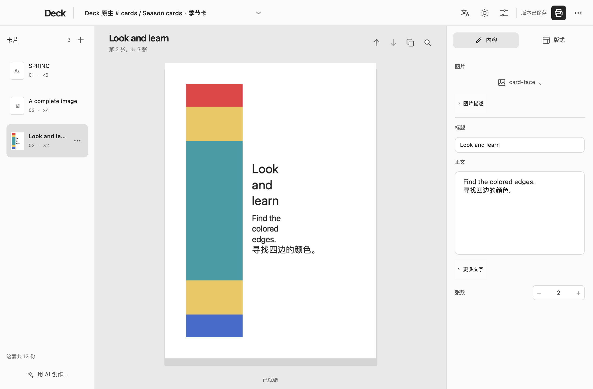
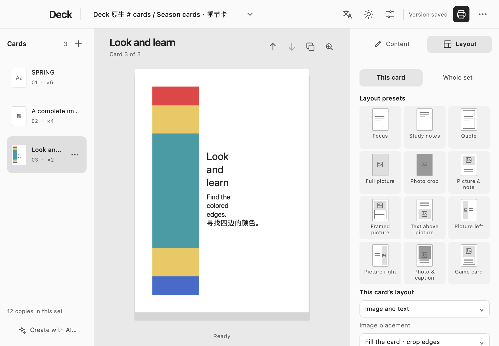
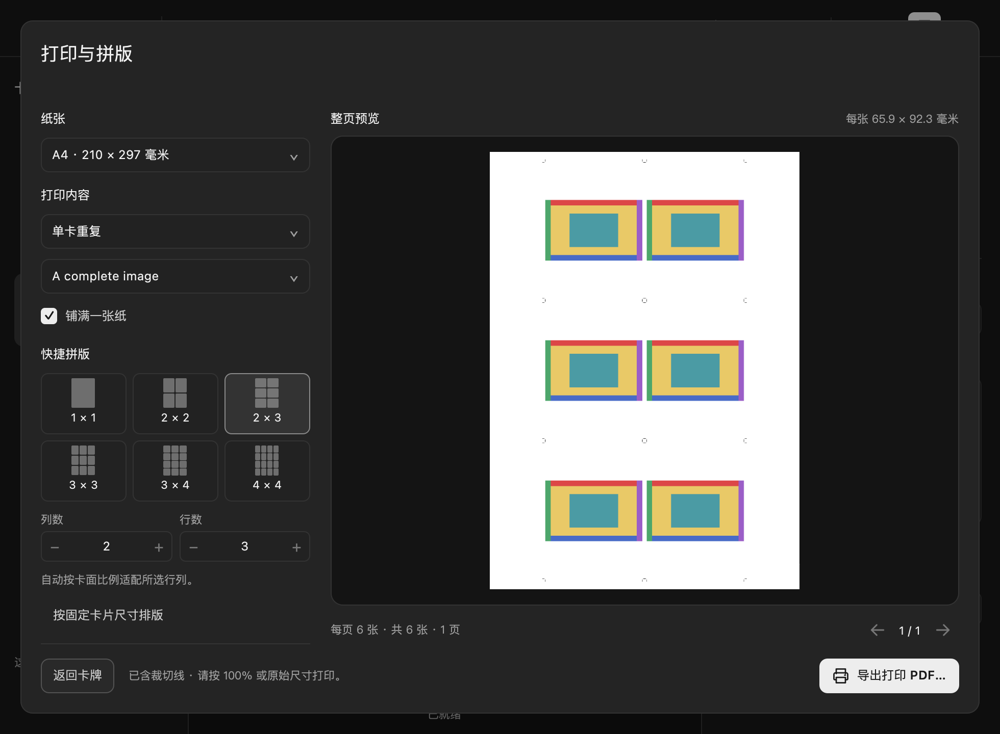

# Deck

**自由制卡，快捷拼版，带线裁切。 · Make cards. Arrange them. Print.**

[简体中文](#简体中文) · [English](#english)

## 简体中文

Deck 是制作和打印卡片的桌面工作台。你可以制作识字卡、观察卡、照片说明、游戏卡，
也可以自由组合文字与图片。编辑卡面、设置张数，再将多张卡片排到同一张纸上，导出带裁切线的 PDF。

项目仍在积极开发中，当前 macOS 构建以 macOS 26 为目标。

### 界面预览

**制卡工作台 · Card editor**



<details>
<summary>查看更多：版式预设与打印拼版 · More: layout presets and printing</summary>

**版式预设 · Layout presets**



**打印拼版 · Print and arrange**



</details>

### 从制作到打印

1. **新建或打开 `.deck` 项目。** 在“添加卡片”中选择空白卡片、现有图片或文字清单。草稿自动保存。
2. **编辑“内容”和“版式”。** 中间查看卡面，右侧修改文字、图片、张数和布局。
   可以设置整组默认版式，也可以单独调整某张卡。
3. **点击标题栏的打印图标。** Deck 检查并采用当前版本后打开拼版预览；已采用的版本直接进入预览。
   选择排版、导出 PDF，再按 **100%／原始尺寸**打印。

将鼠标停在图标上可查看操作提示。打印提示会区分“采用并打印…”和“打印…”。
版本操作与卡面文件导出位于“更多操作”菜单。支持常用的新建、打开和打印快捷键。
在 macOS 上，可拖动 Deck 字样或标题栏空白处移动窗口。

### 卡面设计

- 支持纯文字、完整卡面图片、图文组合；游戏卡字段按需展开。
- 提供 **12 种可视预设**，包括重点卡、学习笔记、引语、图片、照片、说明、边框卡、
  图片位于文字上方或下方、左右图文并排，以及游戏卡。
- 卡面比例与实际打印尺寸独立设置。可调整图片填充和占比、字号、水平与垂直对齐、
  文字位置偏移，以及颜色、边框和留白。
- 含图片的版式在缺图时显示明确占位。未完成的卡片可以保存为草稿；打印前需补齐图片，
  并处理无法以可读字号放入卡面的文字。
- 后续编辑保留卡片身份、可恢复草稿和已采用版本。

### 纸张拼版

支持 A4 和 Letter。可以选择 **1×1 至 4×4 快捷网格**，自定义 **1–8 列、1–8 行**，
或按毫米指定固定卡牌尺寸。不同卡片可按各自张数混排，也可以每种打印一张，
或重复某张卡片铺满纸张、打印指定份数。

预览和导出 PDF 使用相同排版。“微调”可设置纸张边距、卡片间隔和裁切线。
当前实现面向**单面打印**，尚不支持双面对位、出血和混合尺寸装箱。
打印缩放会改变卡牌的实际尺寸，请关闭“适应页面”。

### 语言、外观与 AI

主界面使用黑白灰配色，支持**英文／简体中文**与**浅色／深色／跟随系统**。
未打开项目时也能在标题栏切换；偏好会保存，新配置默认使用浅色。
常用工具采用尺寸统一的矢量图标，附悬停提示和辅助功能名称；项目名与卡片集名保持同一行。

“**用 AI 创作**”通过 [Infer Runtime](https://github.com/glenzli/infer-runtime)
将简短描述生成 **1–16 张卡片的文字建议**。请先在设置中连接 Deck 自己的访问凭据。
请求仅使用本地文字模型，不回退到云端，费用上限为零。检查建议后，再明确添加到当前草稿。
建议不会覆盖已有卡片或自动采用版本；目标项目或草稿变化后需要重新生成。
基础制卡和打印不依赖 AI。

### 可选应用协作

| 连接 | 使用流程 |
| --- | --- |
| [Shape](https://github.com/glenzli/shape) → Deck | 将已保存的卡片集及引用素材带入独立 Deck 项目，之后明确导出 PDF／ZIP 返回。含其他内容的 Shape 项目通过选定卡片集转移。 |
| Deck → Shape | 将某张卡的图片描述发送到独立 Shape 任务；在 Shape 中生成、采用并返回图片，再回到 Deck 检查并用于原卡片。生成权限在 Shape 中配置。 |
| Deck → [Shadow](https://github.com/glenzli/shadow) | 在独立图片编辑器中修改副本，再明确使用返回结果，原图保留。 |

需要时在设置中选择已安装的应用。各应用分别管理自己的项目状态；不支持的交接接口会报错。
旧版 Shape 可能无法识别 Deck 扩展的版式设置，与旧版协作时请使用导出的 PDF 或卡面图片。

### 构建与开发

需要 **Rust 1.96+**、**Qt 6.9+**（Quick、Quick Controls、Concurrent、Multimedia、SVG、
Linguist 工具）、**CMake 3.28+**、**Ninja** 和 **Python 3**。
请将 Qt 工具加入 PATH，或配置 `CMAKE_PREFIX_PATH`。首次构建需要获取锁定的 Cargo 依赖。

```sh
CARGO_TARGET_DIR=../.deck-local-build/cargo cargo test --locked --workspace
cmake --preset desktop-dev
cmake --build --preset desktop-dev
ctest --preset desktop-dev
```

构建产物位于仓库外。构建并打开本地共用调试版：

```sh
./scripts/build_and_promote_debug.sh
./scripts/run_debug.sh
```

调试版脚本通过检查后更新 `../.deck-local-build/current-debug/Deck.app`，
也可以复用已验证的应用包及其匹配的原生检查记录。

桌面应用同时打包 `deck-cli`，通过与界面相同的卡片服务提供机器可读能力和精确版本操作：

```sh
deck-cli capabilities
deck-cli status /absolute/path/cards.deck
```

请求示例和真实 PDF 导出见 [AI 与 CLI 文档](docs/AI.md)；
职责划分见[源码边界](DEV_SKELETON.md)和[应用协作边界](docs/BOUNDARIES.md)。

### 许可与来源

Deck 使用 [MIT 许可证](LICENSE)。CardKit、素材服务和 Qt PDF 实现源自固定版本的
[Shape](https://github.com/glenzli/shape)。为扩展版式，Deck 内置完整 domain/core crate；
其他共享职责由锁定的源码依赖提供，无需另备 Shape 工作目录。
署名、原始文件摘要和有意修改分别记录在 [CardKit 来源清单](third_party/shape-cardkit-provenance.json)
和 [UI 来源清单](third_party/shape-ui/sources.json) 中。

## English

Deck is a desktop workspace for making and printing cards: flashcards, observation cards,
photo captions, game cards, or your own mix of words and pictures. Edit the card face, choose
how many copies you need, and arrange them on a printable sheet with crop marks.

The project is under active development. The current macOS build targets macOS 26.

[View screenshots: editor, layout presets and printing](#界面预览).

### From a card to a printed sheet

1. **Create or open a `.deck` project.** Use **Add cards** to start with a blank card, existing images
   or a text list. Drafts save automatically.
2. **Edit Content and Layout.** The card stays in the center; the inspector holds text, images,
   copies and layout. Set defaults for the whole set or override individual cards.
3. **Choose the printer icon in the title bar.** Deck checks and accepts the current version,
   then opens the sheet preview. If that version is already accepted, it opens directly.
   Choose a layout, export the PDF, and print at **100% / actual size**.

Hover over an icon to see its action. The print tooltip distinguishes **Accept & print…** from
**Print…**. Version and card-file export actions are in **More**. Standard New, Open and Print
shortcuts are available. On macOS, drag the Deck label or empty title-bar space to move the window.

### Card design

- Text-only cards, complete card images, and combined image/text cards; game fields are optional.
- Twelve visual presets covering focus cards, study notes, quotes, pictures, photos, captions,
  framed cards, picture/text arrangements above, below or beside each other, and game cards.
- Card proportions independent of the physical print size; image fit and share; text size,
  horizontal/vertical alignment, position offsets, colors, borders and spacing.
- Clear image placeholders in layouts awaiting artwork. Incomplete cards remain editable drafts;
  missing artwork or text that cannot fit readably must be resolved before printing.
- Stable card identities, recoverable drafts and accepted versions retained across later edits.

### Sheet layout

Use A4 or Letter paper. Pick a quick grid from **1×1 to 4×4**, set **1–8 columns and rows**, or
choose a fixed card size in millimeters. Mix different cards using their quantities, print one
of each, or repeat one selected card to fill a sheet or reach a chosen copy count.

The preview and exported PDF use the same layout. Fine adjustments control margins, card gaps
and crop marks. Current printing is **single-sided**; duplex registration, bleed and mixed-size
packing are outside the implemented scope. Printer scaling changes physical card dimensions,
so disable “fit to page” when printing the PDF.

### Language, appearance and AI

The neutral black, white and grey interface supports **English / Simplified Chinese** and
**Light / Dark / Follow system**. Switch from the title bar even before opening a project.
Preferences persist; new profiles start in light mode. Common tools use consistently sized
vector icons with tooltips and accessible names; the project and card-set heading stays on one line.

**Create with AI** uses [Infer Runtime](https://github.com/glenzli/infer-runtime) to turn a brief
into **1–16 card-text suggestions**. Connect Deck's own access in Settings. Requests use local-only
text generation, no cloud fallback and a zero-cost ceiling. Review the results and explicitly
add them to the current draft. Suggestions do not replace cards or accept a version; changes to
the target project or draft require a new generation. Basic editing and printing work without AI.

### Optional application connections

| Connection | Workflow |
| --- | --- |
| [Shape](https://github.com/glenzli/shape) → Deck | Continue a saved card set with its referenced materials in an independent Deck project; explicitly export PDF/ZIP outputs to return. Mixed Shape projects use this selected-card transfer. |
| Deck → Shape | Send a card's image instruction to a separate Shape task. Accept and return the image there, then review and use it on the original card in Deck. Generation access is configured in Shape. |
| Deck → [Shadow](https://github.com/glenzli/shadow) | Refine a copy in the independent image editor, then explicitly use the returned result. The original image is retained. |

Choose the installed applications in Settings when needed. Each application owns its own project
state. Unsupported handoff interfaces report an error. Older Shape versions may not understand
Deck's extended layout controls; use exported PDFs or card images with those versions.

### Build and development

Requirements: **Rust 1.96+**, **Qt 6.9+** with Quick, Quick Controls, Concurrent, Multimedia, SVG
and Linguist tools, **CMake 3.28+**, **Ninja** and **Python 3**. Put Qt's tools on your PATH or
configure `CMAKE_PREFIX_PATH`. The first build needs access to the locked Cargo dependencies.

```sh
CARGO_TARGET_DIR=../.deck-local-build/cargo cargo test --locked --workspace
cmake --preset desktop-dev
cmake --build --preset desktop-dev
ctest --preset desktop-dev
```

Build products stay outside the checkout. For the shared local debug application:

```sh
./scripts/build_and_promote_debug.sh
./scripts/run_debug.sh
```

The promotion helper validates the build before updating
`../.deck-local-build/current-debug/Deck.app`. It can also reuse an already validated bundle
with its matching native-smoke evidence.

The desktop packages a sibling `deck-cli` for machine-readable capabilities and exact-version
actions through the same card services:

```sh
deck-cli capabilities
deck-cli status /absolute/path/cards.deck
```

See [AI and CLI usage](docs/AI.md) for requests and actual native PDF export,
[source boundaries](DEV_SKELETON.md) and [application connections](docs/BOUNDARIES.md) for ownership.

### License and source provenance

Deck is [MIT licensed](LICENSE). Its CardKit, material services and Qt PDF implementation derive
from a fixed [Shape](https://github.com/glenzli/shape) revision. The complete domain/core crates are
vendored for Deck's layout extensions; other shared owners come from the locked source dependency.
A separate Shape checkout is unnecessary. Attribution, base hashes and deliberate adaptations are
recorded in [CardKit provenance](third_party/shape-cardkit-provenance.json) and
[UI provenance](third_party/shape-ui/sources.json).
