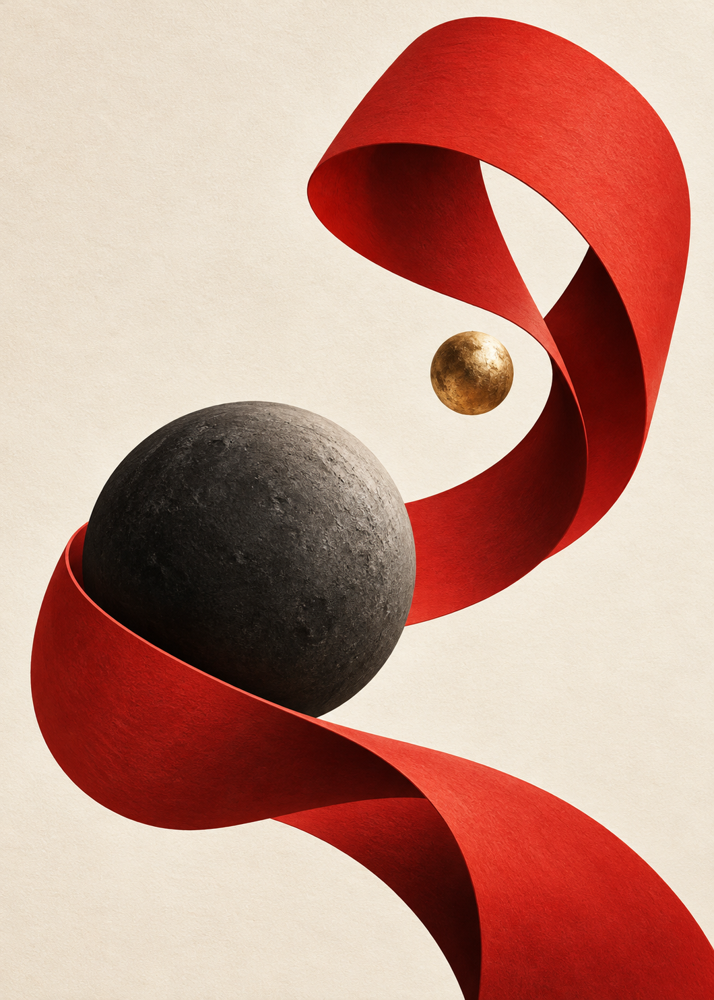
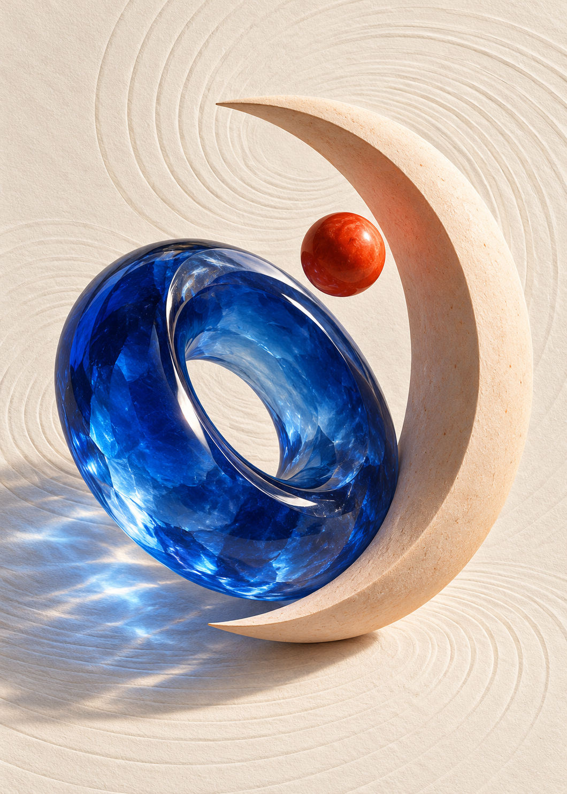
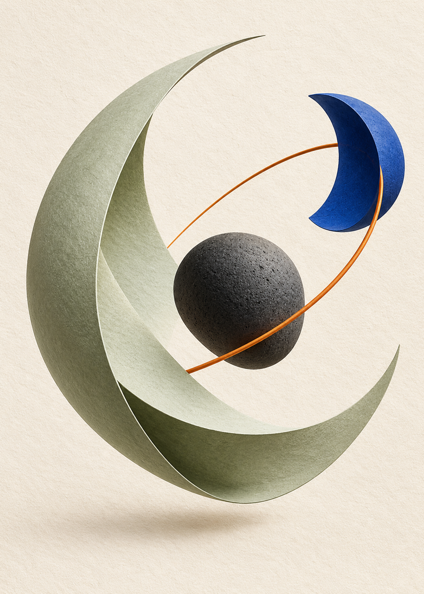

# 形与引力 · FORM

为 Deck 界面示例制作的三张抽象艺术卡面：**引力、共振、轨道**。
使用内置 image_gen 生成，保留纸张、玻璃与陶瓷的肌理；卡面未烘焙文字，可作为完整卡面导入。

Three abstract art faces made for Deck's documentation: **Gravity, Resonance, Orbit**.
Generated with the built-in image_gen tool. The artwork has no baked-in text and can be imported as complete card images.

| 引力 · Gravity | 共振 · Resonance | 轨道 · Orbit |
| --- | --- | --- |
|  |  |  |

[完整提示词 · Full prompts](prompts.json)
